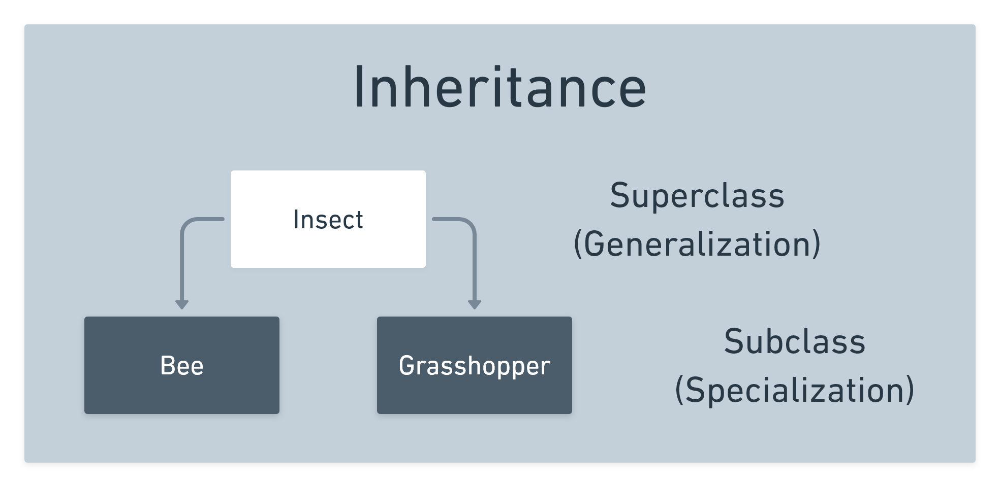
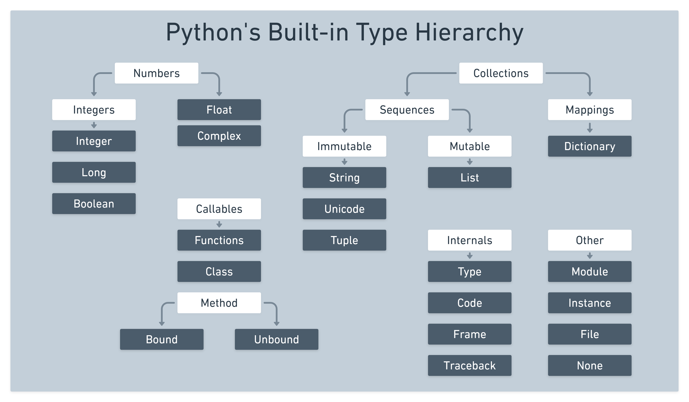

# 

**Learning objective:** By the end of this lesson, students will be able practice inheritance in Python.

## Inheritance

Maybe the following graphic will jog your memory in regards to what inheritance is:

tktk - Hunter this was ported over from the notion content


Using inheritance, a **subclass** automatically inherits all of the attributes and methods of its **superclass**.

The **subclass** can then define additional attributes and/or methods to make a more *specialized* class than the superclass.

For example, in the JS Classes lesson, we specialized the `Vehicle` class by *extending* it to create a `Plane` subclass.

Let’s see how inheritance is implemented in Python by creating a `ShowDog` class that specializes the `Dog` class:

```python
# Pass in superclass as argument
class ShowDog(Dog):
  # Add additional parameters AFTER those in the superclass
  def __init__(self, name, age = 0, total_earnings = 0):
    # Always call the superclass's __init__ first
    Dog.__init__(self, name, age)
    # Now add any new attributes
    self.total_earnings = total_earnings
```

> If not specified, the default superclass is Python’s object class.

It’s show time!

```python
winky = ShowDog('Winky', 3, 1000)
print(winky) # Yay, inherited the overriden __str__
winky.bark() # Yay, inherited the bark method
print(winky.total_earnings) # -> 1000
winky.add_prize_money(500) # New method that 'Dogs' don't have
print(winky.total_earnings) # -> 1500
```

Inheritance is critical to OOP languages. In fact, they even have their own **object hierarchies**. Check this out:

tktk - Hunter this was ported over from the notion content


Frameworks like Django and Rails have elaborate object hierarchies of their own. For example, when we move on to Django, we’ll be defining Models by inheriting from a Django class like this:

```python
class Person(models.Model):
```

# Review Questions ❓

Take a couple of minutes to review these…

1. What’s the difference between a class and an object?
2. What Python keyword is used to define a class?
3. How do we create objects using a class?
4. True or False: Class attributes are shared by all instances of that class.
5. What OOP principle refers to subclasses specializing superclasses?
